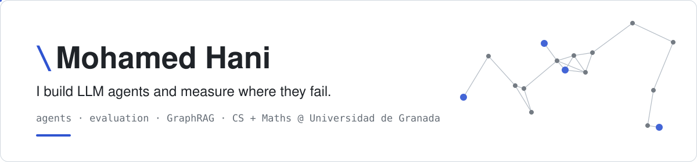

<picture>
  <source media="(prefers-color-scheme: dark)" srcset="assets/banner-dark.svg">
  
</picture>

  
  
  
  

I'm Hani. I study Computer Science and Mathematics (double degree) at the Universidad de Granada
and work as a research intern on agents for LaTeX. Most of what I build is LLM agents over real,
messy domains like law and scientific writing, and then the evaluations that show where they
break.

**Now:** LLM evaluation (why grounding prompts make models ignore what they know), an agent that
edits LaTeX projects, and a lot of real analysis.

### Selected work

| | Project | What it is |
|---|---|---|
| 🔬 | **[placebo-bench](https://github.com/mhanii/placebo-bench)** | Does "answer only from the context" plus forced choice suppress what an LLM knows? A factorial benchmark (prompt × context × memorization tier) with a contamination-free tier. Pilot done; full run next. |
| ⚖️ | **[Athen · Corolaria](https://github.com/mhanii/corolaria)** | Legal research copilot for Spanish and EU law. GraphRAG over BOE, EUR-Lex and case law, a LangGraph research agent, and citations to the exact article version. 98/100 on an official judiciary exam (internal run). |
| \\ | **[dBackSlash](https://github.com/mhanii/dbackslash)** | Research project (UGR): an agent built into an Overleaf fork that reads, edits, compiles and fixes LaTeX, with every edit as a tracked change. |
| 📝 | **[Ofida](https://ofida.mhanii.com)** | Live web simulator of Word and Excel 365 for the Spanish civil-service office exam, with auto-graded tasks from real past exams. |
| 🎮 | **MOGOFF** | Real-time computer-vision party game (MediaPipe, plugin mini-game engine, LLM-judged rounds). 1st place, Cursor Hackathon Madrid 2026. |
| 🧩 | **[Drongo](https://github.com/mhanii/Drongo)** | Multi-agent document editor: LangGraph agents edit a live document through interrupt-driven client tools. |

### Tools I reach for

  

LangGraph · Neo4j · Qdrant · MediaPipe · Vercel AI SDK · coding agents

### Also

- Lectures on LLM fundamentals and AI agents at the ETSIIT Tech Club
- Co-founded the Competitive Programming Club at ETSIIT
- Small C++ fixes in LibreOffice
- Arabic, English, Spanish and Turkish. Learning French.
